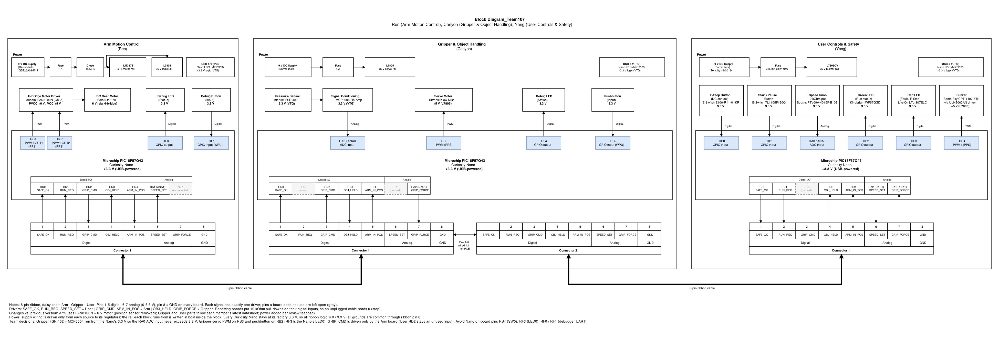

## Introduction
**This block diagram shows how our team's three boards work together in a pick-and-place robotic arm system. Each board uses a Microchip PIC18F57Q43 Curiosity Nano and handles one function: Arm Motion Control drives a 6 V gearmotor through a FAN8100N H-bridge; Gripper & Object Handling drives the Kitronik Klaw Mk2 servo and reads an FSR 402 force sensor; User Controls & Safety reads the E-stop, start/pause button and speed knob and drives the status LEDs and buzzer.**

**The boards are connected in a daisy chain with 8-pin ribbon cables. Pins 1–5 carry digital signals (SAFE_OK, RUN_REQ, GRIP_CMD, OBJ_HELD, ARM_IN_POS), pins 6–7 carry analog signals (SPEED_SET, GRIP_FORCE), and pin 8 is GND. Every sensor and actuator connects only to its own board's microcontroller, so only high-level status and command signals cross between boards. Arrows show signal direction.**

**Power is drawn the same way on every board: supply wiring is shown only from each source (9 V wall adapter or the PC's USB port) to its regulators, and the rail each block runs from is written in bold inside the block instead of drawing a supply line to it. Every Curiosity Nano runs at its factory 3.3 V from USB, so all ribbon signals are 0 / 3.3 V, and all grounds are common through ribbon pin 8.**

## Research Question

* With only have 8-pin connectors. How to divide functionality across the team in a way that minimizes interconnections between teammates?
* Does the system layout ensure each teammate meets minimum project requirements?
* What are the risks to the current system if lose a teammate? How to de-risk the system design by grouping and/or distributing similar functions between teammates?

## Images

**Figure 1:** Team block diagram (click the image to enlarge).

## Results
1. We divided the system by physical ownership. Every sensor and actuator is wired only to the microcontroller on its own board, so no raw sensor or motor signal ever crosses a ribbon cable. Only high-level status and command signals are shared between boards. This keeps the whole team within 7 usable pins. 
2. Yes. Each board has its own microcontroller, at least one ribbon connector, and at least one sensor or actuator: the Arm board has a motor and a position sensor, the Gripper board has a servo plus object and force sensors, and the User board has an E-stop, buttons, a speed knob, LEDs and a buzzer. The three roles are unique. Together they use different peripherals. 
3. Losing the User board means SAFE_OK is never driven, so the system stays safely stopped and cannot run. Losing the Gripper board breaks the chain between the other two boards, because it sits in the middle. Losing the Arm board removes all motion. We reduce these risks in four ways: 
  (1).Every connector has a test header, so jumpers can simulate a missing teammate's signals and the other boards can still be tested. 
  (2). We use a cable that can run directly from the Arm board to the User board, so the chain survives without the Gripper board. 
  (3). All three boards use the same MCU, the same pin map and a shared handshake module, so any teammate can write a stub for another board's interface. 
  (4). The Arm board gets a local stop input that is ANDed with SAFE_OK in hardware, so safety does not depend on a single board. 

## Conclusions and Future Work

## Design Decision-Making Process

The team divided the robotic arm into three independent
subsystems: Arm Motion Control, Gripper & Object Handling,
and User Controls & Safety.

This architecture was selected to simplify hardware
development, reduce communication complexity, and
allow each subsystem to be tested independently.

The User Controls & Safety subsystem uses a PIC18F57Q43
Curiosity Nano to monitor the emergency stop, Start/Pause
button, and speed control potentiometer.

LED indicators and a ULN2003A buzzer driver provide
visual and audible feedback.

The 8-pin team connector allows the subsystem to
exchange control and status signals with the other boards.

### Relationship to Product Requirements

| Subsystem | Related Requirements |
|---|---|
| Arm Motion Control | PR-01, PR-02, PR-04 |
| Gripper & Object Handling | PR-03, PR-08 |
| User Controls & Safety | PR-07, PR-12, PR-14, PR-15 |

The modular design allows each subsystem to support
specific product requirements while contributing
to the overall pick-and-place operation.

The emergency-stop circuit provides stop-request
monitoring. The final motion-stopping behavior
must be verified during system integration.

## Conclusions and Future Work

The current block diagram establishes the hardware
architecture and communication interfaces for Team 107.

Future work includes verifying connector pin assignments,
testing communication between the three microcontrollers,
and validating the safety and control functions.

The block diagram will be updated as necessary
based on integration testing and instructor feedback.

## Resources

The block diagram source files (editable draw.io file and exported PNG) are available as a [*Zip download*](image/Team107_Team_Block_Diagram_source.zip). The draw.io file can also be opened directly: [*Team107_Team_Block_Diagram.drawio*](image/Team107_Team_Block_Diagram.drawio).

