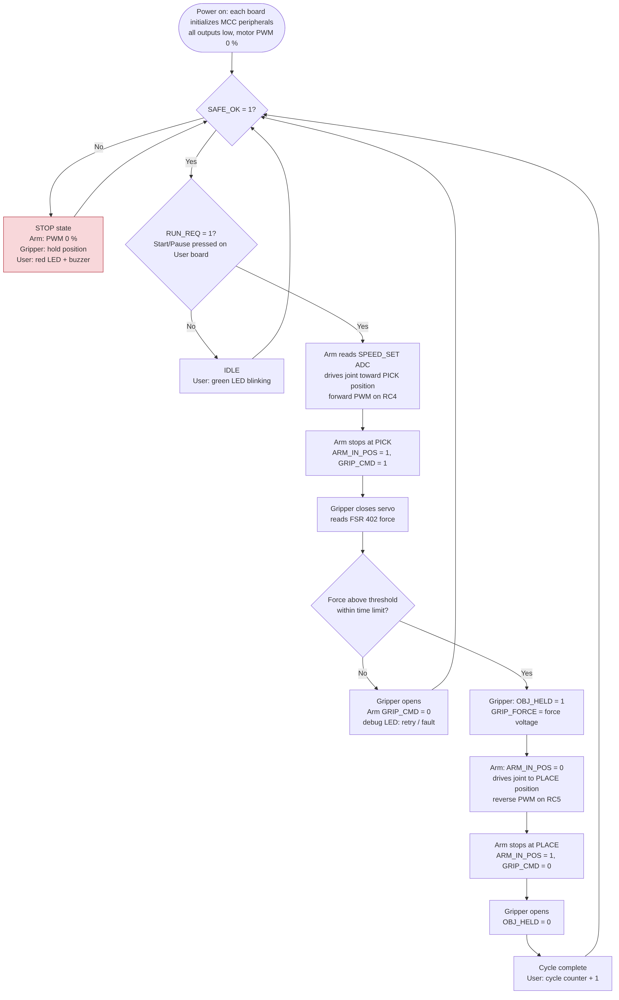

## Introduction

The process diagram shows how one pick-and-place cycle runs across Team 107's three boards: **User Controls & Safety** (Dunyue Yang), **Arm Motion Control** (Yixiang Ren) and **Gripper & Object Handling** (Canyon Miller). Each board has its own column. Arrows between columns are changes on the 8-pin ribbon cable; the exact signals are defined on the [Message Structure](09-Message%20Structure.md) page, and the firmware behind each box is described in the [Software Proposal](07-Software%20Proposal.md).

## Research Question

*How do three independent microcontrollers, linked only by eight parallel wires, take turns to complete a pick-and-place cycle safely, and what happens when something goes wrong?*

The diagram answers this by showing, for every step, which board acts, which signal it changes, and which board is waiting for that change. It also shows the stop path that every board checks on every loop.

## Process Diagram

**Figure 1:** Process diagram for one pick-and-place cycle (click to enlarge).

## How to Read the Diagram

1. **Power-up.** Each board initializes with every output low and its motor or servo stopped. The Arm and Gripper boards wait.
2. **Start.** When the E-stop is released, the User board sets SAFE_OK = 1. When the user presses Start, it sets RUN_REQ = 1 and outputs the speed knob value on SPEED_SET.
3. **Move to pick.** The Arm board drives the joint forward with PWM on RC4 at the requested speed. When the move is done it sets ARM_IN_POS = 1 and GRIP_CMD = 1.
4. **Grip.** The Gripper board closes the claw until the FSR 402 reaches the force threshold, then sets OBJ_HELD = 1. It also outputs the measured force on GRIP_FORCE, and the User board displays it.
5. **Move to place.** The Arm board clears ARM_IN_POS and drives the joint in reverse with PWM on RC5. At the place position it sets ARM_IN_POS = 1 and GRIP_CMD = 0.
6. **Release.** The gripper opens and clears OBJ_HELD. The User board counts the cycle. If RUN_REQ is still 1, the cycle repeats.
7. **Stop path (any time).** If SAFE_OK becomes 0 because the E-stop is pressed, a fault occurs, or the cable is unplugged, the Arm board sets both PWM outputs to 0 %, the Gripper board holds, and the User board turns on the red LED and buzzer. The user must release the E-stop and press Start again to continue.

## Results

1. **We divided the system by physical ownership.** Every sensor and actuator is wired only to the microcontroller on its own board, so no raw sensor or motor signal crosses the ribbon cable. Only status, command and two 0–3.3 V analog values are shared, and they fit in 7 signal pins plus ground.
2. **Each board meets the subsystem requirements.** Each board has its own microcontroller, a ribbon connector, and at least one sensor or actuator:
    * the Arm board has the DC gearmotor and FAN8100N H-bridge;
    * the Gripper board has the servo claw and the FSR 402 force sensor;
    * the User board has the E-stop, Start/Pause button, speed knob, LEDs and buzzer.
3. **What happens if one board is missing, and how we reduce the risk.**
    * Losing the User board: SAFE_OK is never driven, the pull-downs read 0, and the system stays safely stopped.
    * Losing the Arm board: no motion happens.
    * Losing the Gripper board: GRIP_CMD has no answer, so the Arm board times out and stops.

    We reduce these risks in four ways:

    1. Every input has a pull-down, so a missing board or cable reads as "stop".
    2. Each signal has one driver, so any board can be tested alone by pulling its inputs high or low with jumpers.
    3. All three boards use the same PIC18F57Q43 Curiosity Nano and the same ribbon pin order, so any teammate can write a stub for another board.
    4. The Gripper board passes every ribbon pin straight through (1:1), so the User board's SAFE_OK reaches the Arm board on the same wire.

## Resources

The diagram source (Mermaid `.mmd` file and exported PNG) is available as a [*Zip download*](image/Team107_Process_Diagram_source.zip). The `.mmd` file can be edited at [mermaid.live](https://mermaid.live).
