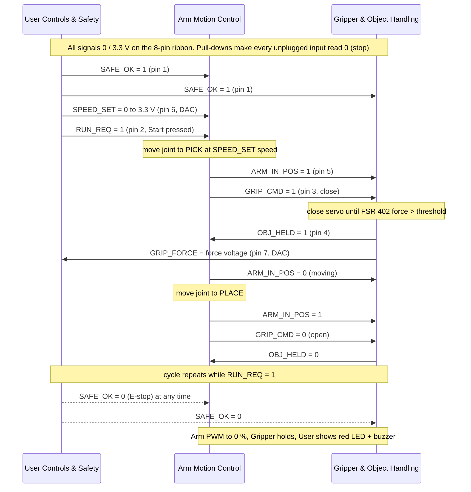

## Introduction

Team 107's boards do not exchange serial messages. Each "message" is the level of one wire on the **8-pin ribbon cable** that links the User Controls & Safety, Gripper & Object Handling and Arm Motion Control boards in a daisy chain. This page defines every signal and the order in which they change during a cycle. The [Process Diagram](08-Process%20Diagram.md) shows the same cycle from each board's point of view.

## Signal Definitions

All logic signals use 0 / 3.3 V levels, because all three Curiosity Nanos run at 3.3 V. Each signal has exactly **one driver**. The Gripper board passes all eight pins straight through (1:1), so every board sees every signal.

| Pin | Signal | Type | Driver | Receiver(s) | 1 / high means | 0 / low means | Unplugged reads |
|---|---|---|---|---|---|---|---|
| 1 | SAFE_OK | Digital | User (RD0) | Arm, Gripper | Safe to run | Stop now | 0 (stop) |
| 2 | RUN_REQ | Digital | User (RD1) | Arm | Start / continue cycle | Pause after current move | 0 |
| 3 | GRIP_CMD | Digital | Arm (RD2) | Gripper | Close gripper | Open gripper | 0 (open) |
| 4 | OBJ_HELD | Digital | Gripper (RD3) | Arm, User | Object held (force ≥ threshold) | Not holding | 0 |
| 5 | ARM_IN_POS | Digital | Arm (RD4) | Gripper, User | Arm is at its target | Arm is moving | 0 |
| 6 | SPEED_SET | Analog 0–3.3 V | User DAC (RA2) | Arm ADC (RA1) | Higher voltage = faster | 0 V = slowest | 0 V |
| 7 | GRIP_FORCE | Analog 0–3.3 V | Gripper DAC (RA2) | User ADC (RA1) | Higher voltage = more force | 0 V = no force | 0 V |
| 8 | GND | Ground | — | all | Common reference | | |

**Electrical rules**

* Every digital input has a 10 kΩ pull-down, so a missing cable or an unpowered board reads 0.
* Every digital output has a 330 Ω series resistor, which limits current if two boards ever drive the same wire by mistake.
* Analog inputs have a 1 kΩ / 0.1 µF RC filter before the ADC.
* The connectors are keyed 2 × 4 shrouded headers, so the cable cannot be plugged in backwards.

## Message Sequence

**Figure 1:** Signal sequence for one pick-and-place cycle and the stop path (click to enlarge).

## Handshake Rules

1. **Nothing moves without SAFE_OK = 1.** Both the Arm and Gripper boards check SAFE_OK at the top of every loop. A 0 stops all motion immediately, whatever state the board is in.
2. **The Arm board leads the cycle.** It starts only when SAFE_OK = 1 and RUN_REQ = 1, and it is the only board that drives GRIP_CMD and ARM_IN_POS.
3. **The Gripper board acts only when the arm is in position.** It closes on GRIP_CMD = 1 only while ARM_IN_POS = 1, and opens on GRIP_CMD = 0.
4. **The Arm board waits for OBJ_HELD before carrying an object.** If OBJ_HELD does not rise within the grip timeout, the arm clears GRIP_CMD and retries once, then shows a fault.
5. **Restart is deliberate.** After any stop, the User board drops RUN_REQ. The user must release the E-stop and press Start again.
6. **Analog values are advisory.** SPEED_SET only scales the arm's PWM duty, and GRIP_FORCE is only displayed. A bad analog value cannot start motion on its own.

## Example: one cycle on the wires

| Step | SAFE_OK | RUN_REQ | ARM_IN_POS | GRIP_CMD | OBJ_HELD | What is happening |
|---|---|---|---|---|---|---|
| Idle | 1 | 0 | 0 | 0 | 0 | Waiting for Start |
| Start | 1 | 1 | 0 | 0 | 0 | Arm moving to pick |
| At pick | 1 | 1 | 1 | 1 | 0 | Gripper closing |
| Gripped | 1 | 1 | 1 | 1 | 1 | Object held |
| Carrying | 1 | 1 | 0 | 1 | 1 | Arm moving to place |
| At place | 1 | 1 | 1 | 0 | 1 | Gripper opening |
| Released | 1 | 1 | 1 | 0 | 0 | Cycle counted; repeat |
| E-stop | 0 | 0 | x | x | x | All motion stopped |

## Resources

The sequence diagram source (Mermaid `.mmd` file and exported PNG) is available as a [*Zip download*](image/Team107_Message_Structure_source.zip). The `.mmd` file can be edited at [mermaid.live](https://mermaid.live).
